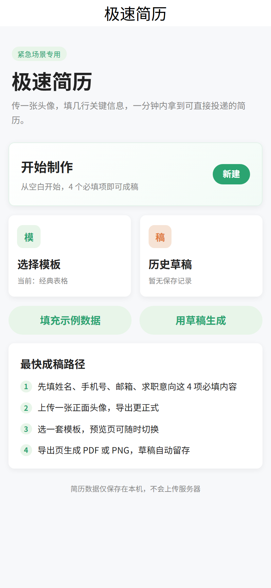
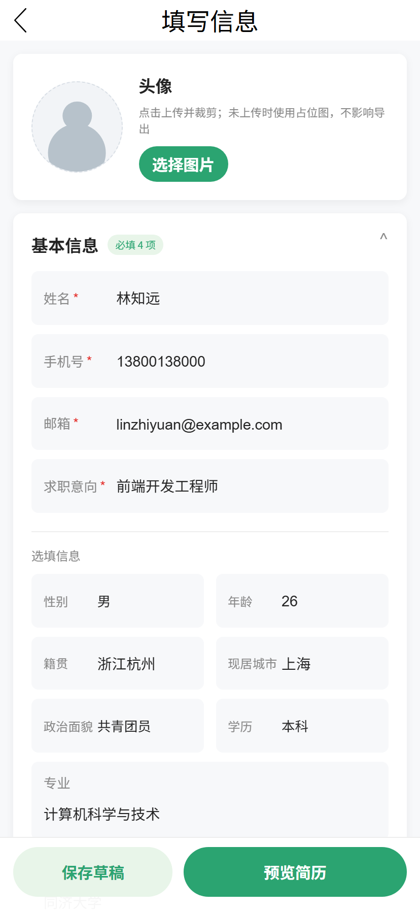
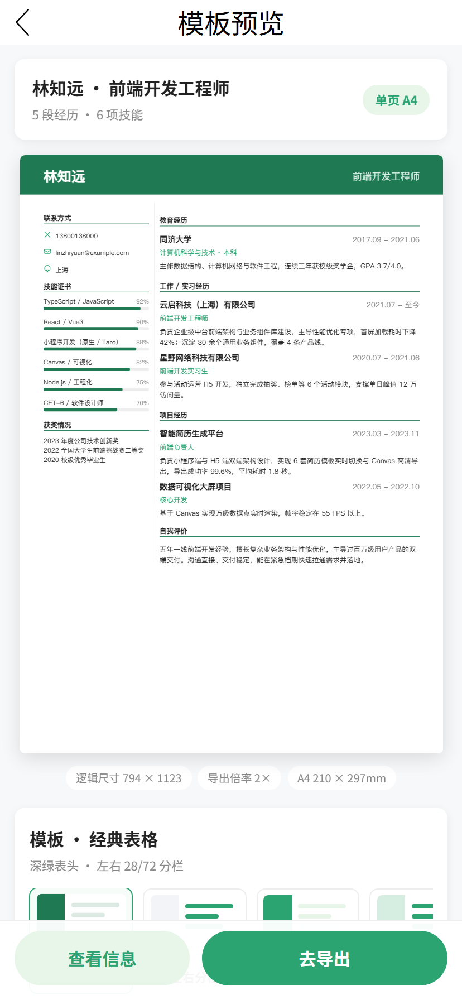
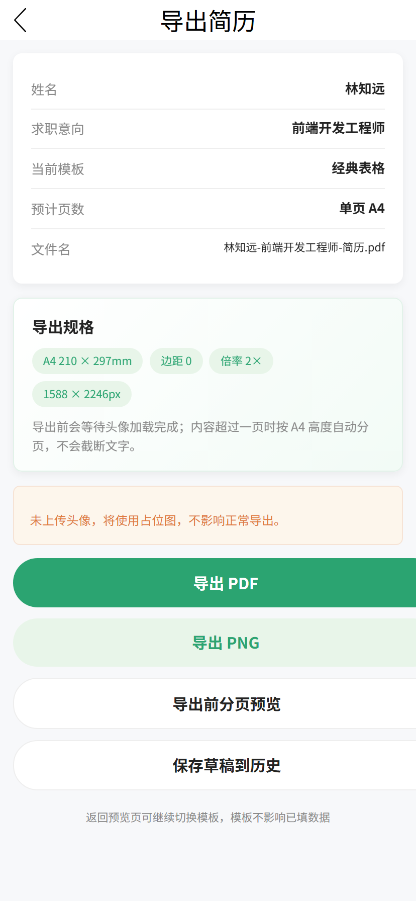
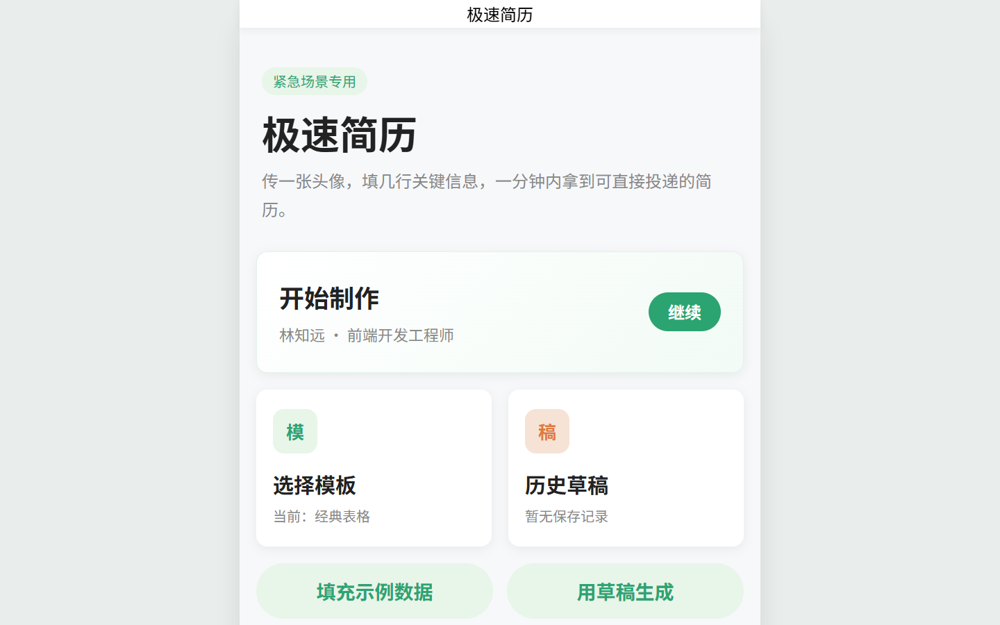
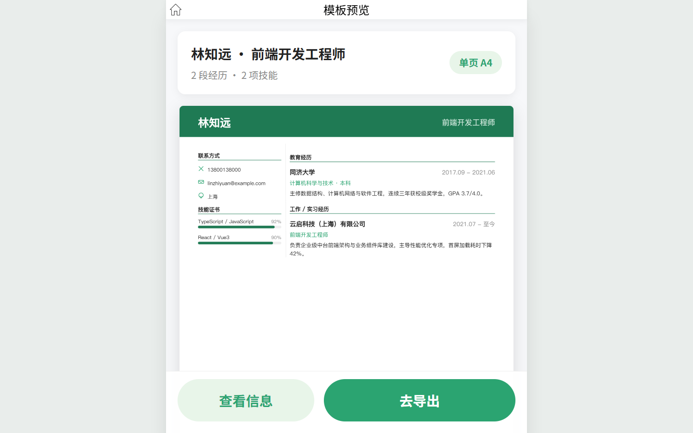

# 极速简历

各位好，欢迎各位使用我的项目，如果出现问题请及时联系我liuwei12333x@gmail.com

由个人作品「极速简历」在Claude code的帮助下完成，可直接在浏览器中运行。
数据存放：浏览器 `localStorage`，无后端、无统计、无追踪

> 仓库内示例简历中的姓名、手机号、邮箱、学校、公司等全部为虚构演示数据
> （邮箱使用 `example.com` 保留域名），与仓库作者及任何真实个人无关。

## 下载使用（Windows 免安装版）

前往 [Releases](https://github.com/NeilXavier/crash-resume/releases) 下载
`crash-resume-v1.0.0-windows-x64.zip`：

1. 解压整个文件夹（保留 `dist` 目录，不要只拖出 exe）
2. 双击 `start.bat`，或直接双击 `CrashResume.exe`
3. 浏览器自动打开 http://localhost:10087/

不需要安装 Node.js，也不需要联网。程序只监听本机 `127.0.0.1`；简历数据只保存在当前浏览器。
首次运行若出现 Windows SmartScreen 提示，点「更多信息」→「仍要运行」即可。

## 界面预览

| 手机端首页 | 填写信息 |
| --- | --- |
|  |  |
| **简历预览** | **导出页** |
|  |  |

桌面端会居中显示 750px 宽的「手机画布」，两侧留白：

| 桌面端首页 | 桌面端预览 |
| --- | --- |
|  |  |

## 功能

- 首页 → 填写 → 预览 → 导出 的完整流程，hash 路由，无需服务端
- 4 项必填信息（姓名、手机号、邮箱、求职意向），支持多段教育 / 工作 / 项目经历
- 多套简历模板，预览页可随时切换，不影响已填内容
- 草稿自动保存在本地，支持继续编辑与历史草稿
- 导出 PNG 长图（2 倍分辨率）与 A4 PDF，内容超过一页时自动分页
- 电脑端居中 750px 布局，底部操作栏、弹层、模板选择框同步居中

## 快速开始

需要 Node.js 18+（实测 v24.16.0）。

### 预览生产构建

```bash
npm install
npm run build:h5
npm run serve:h5
```

浏览器打开 http://localhost:10087/ 即可。

`dist/` 中已经包含构建产物，若只想预览，可跳过前两条命令，直接：

```bash
npm run serve:h5
```

静态服务器默认使用 `10087`，端口冲突时可用
`PORT=10088 npm run serve:h5` 指定其他端口。

### 开发模式

```bash
npm run dev:h5
```

`dev:h5` 自带开发服务器（默认 http://localhost:10086/，端口被占用时自动顺延，
以终端打印的地址为准），修改源码后自动热更新，**不需要**再运行 `serve:h5`。

> **两个命令不要同时运行。** `dev:h5` 使用内存构建并会清空 `dist/`，
> 此时 `serve:h5` 找不到任何文件，浏览器只会显示 `Not found`。
> 需要预览生产包时，先停掉 dev，再依次执行 `build:h5` 和 `serve:h5`。

### 构建 Windows 免安装包

```powershell
npm run build:h5
powershell -ExecutionPolicy Bypass -File scripts/build-release.ps1 -Version 1.0.0
```

产物为 `release/crash-resume-v1.0.0-windows-x64.zip`，包含 `dist/`、
`CrashResume.exe`、`start.bat`、`README.txt`。启动器使用 Windows 自带的
.NET Framework 4.x 编译，不需要安装 Node.js，也不需要额外下载运行时。

## 环境变量与密钥

当前版本不需要任何环境变量，仓库里也没有 `.env` 文件。

为什么不要把 `.env` 提交到 GitHub：

1. `.env` 放的是「当前这台机器」的运行配置，换一台机器就要改，不适合作为源码共享。
2. 公开仓库的任何人都能看到里面的值。即使项目现在没有用户，泄露的密钥也可能被扫描并滥用。
3. 密钥一旦进入 Git 历史，即使后来删掉文件，历史提交里仍然存在；必须去服务商后台作废重发，成本很高。


## 隐私与数据

- 简历内容、头像、历史草稿只写入当前浏览器的 `localStorage`，不会上传到任何服务器。
- 项目没有后端接口、统计脚本或第三方追踪代码。
- PNG/PDF 均在浏览器本地用 Canvas 生成，导出过程不联网。
- 清除浏览器站点数据（或换浏览器、换设备）会丢失草稿，请及时导出文件。
- 仓库不包含真实账号、Cookie、Token、密钥、内网地址或作者个人信息。
- 源码与文档中唯一出现的 IP 是 `127.0.0.1`，属于本机回环地址，仅供本地预览服务使用，不是公网地址。

## 页面

使用 hash 路由：

| 页面 | 地址 |
| --- | --- |
| 首页 / 模板选择 | `#/pages/index/index` |
| 编辑表单 | `#/pages/form/index` |
| 预览 | `#/pages/preview/index` |
| 导出 | `#/pages/export/index` |

## 已修复的 Bug

### 1. PNG 导出成功却没有保存弹窗

`src/pages/export/index.tsx` 中，PNG 导出成功后的保存提示把
`confirmText` 写成了 5 个汉字的 `保存到相册`。Taro 的 `showModal`
限制按钮文案最多 4 个汉字，超限时接口直接失败，导致弹窗不出现、
文件也无法下载。

```diff
-        confirmText: '保存到相册',
+        confirmText: '保存',
```

### 2. PDF 导出空白

PDF 中声明的是 `/Filter /FlateDecode`，实际写入的却是完整的 PNG 文件字节。
PNG 不能直接作为 Flate 图像流解码，所以查看器能打开、页面尺寸也正常，但内容全白。

修复：H5 与小程序端导出 PDF 时统一改用 JPEG（`/Filter /DCTDecode`，质量 0.94）；
`buildPdf` 增加校验，传入非 JPEG 数据时直接报错，避免再次生成空白文件。

实测：内嵌图像为 1588×2246 的 JPEG，PDF 在 Chrome 查看器中正常显示中文内容。

### 3. 桌面端布局被拉宽

750 设计稿在宽屏上铺满窗口，卡片过宽、字号偏小，滚动条挤在内容列内部。

修复：宽屏下导航栏与页面统一限制为 750px 并居中，隐藏内容列内部滚动条；
底部操作栏、弹层、模板选择框同步居中；画布宽度上限 750px 并监听窗口缩放。

### 4. 「继续」按钮点击不灵敏

卡片悬停时的 `translateY(2px)` 会移动命中区域，鼠标停在边缘会反复触发
移入/移出，表现为点击没有反应。

修复：悬停只改变透明度与背景色，去掉所有位移；点击后加锁防止重复跳转，
并显示「进入中…」；跳转失败时自动回退并提示。

## 目录说明

```
src/                 源码
config/index.ts      Taro 构建配置
scripts/serve.js     零依赖静态预览服务器（默认端口 10087）
scripts/build-release.ps1  Windows 免安装包构建脚本
scripts/portable/    免安装版启动器源码、启动脚本与使用说明
dist/                预构建的 H5 产物
screenshots/         手机端与桌面端页面截图
release/             本地生成的发行包（已忽略，不提交）
.env.example         环境变量占位示例（不含真实值）
.gitignore           忽略依赖、缓存、日志与 .env
.gitattributes       统一换行与二进制文件处理
package.json         依赖与脚本
package-lock.json    锁定依赖版本
tsconfig.json        TypeScript 配置
```

## 说明与限制

- `src/index.html` 是构建模板（含 EJS 占位符），**不能直接在浏览器打开**；
  可运行的是构建后的 `dist/index.html`，请通过 `npm run serve:h5` 访问。
- 本工程是根据浏览器可见的前端快照还原的，`package.json`、`config/index.ts`、
  `tsconfig.json`、`src/index.html` 等构建文件按 Taro 4 官方模板补齐，
  不是原 QMuse 工程文件。
- 依赖未打包（`node_modules/` 体积过大），执行 `npm install` 安装。
- 头像上传/裁剪依赖真实的小程序文件选择能力；H5 端只能验证界面与流程。
- 保存到相册、相机等原生能力需在支付宝/微信小程序真机环境验证；
  当前工程只配置了 H5 构建，小程序构建还需补充 `project.config.json`
  及各平台配置。
- 快照不包含登录态、Cookie 或账号信息。

## 反馈

发现问题可在仓库 Issues 中反馈。请勿在 Issue、截图或日志中粘贴真实简历内容、
手机号、邮箱、Token、密钥或服务器地址。

## 版权与许可
本项目仅供学习、交流与技术参考使用。
**原创声明**：本项目代码及文档除特别标注外，均为作者独立创作或基于公开信息整理。
**侵权处理**：作者已尽力尊重第三方知识产权。若本项目内容涉嫌侵犯贵方的著作权、商标权或其他合法权益，请务必通过正规渠道（GitHub Issues 或邮件）联系本人并提供相关权属证明。核实后，本人承诺将立即删除侵权内容或停止相关行为。
**默认条款**：若贵方在合理期限内未提出有效联系与主张，则视为贵方暂不追究相关责任。本项目保留最终解释权与修改权。
